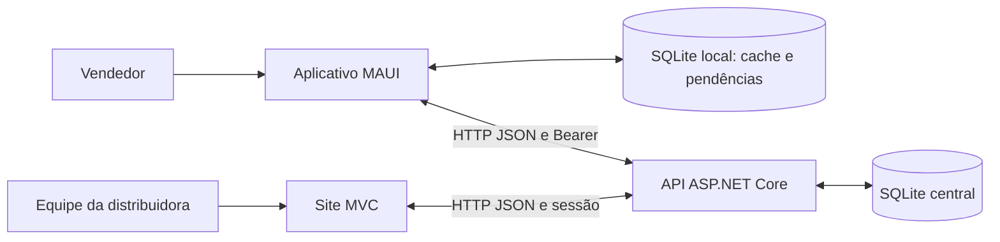

# Panifica B2B

Sistema acadêmico para distribuidora de produtos de panificação: .NET 10/C#, API ASP.NET Core, site MVC e aplicativo .NET MAUI. SQLite central separado do SQLite do vendedor. O site acessa o banco exclusivamente pela API.

**Estado da validação:** resultados automatizados em VALIDACAO.md; teste manual completo da interface e do dispositivo ainda pendente.

Especificação: [escopo](docs/ESPECIFICACAO.md), [lógica](docs/LOGICA-DO-SISTEMA.md) e [modelo de dados](docs/MODELO-DE-DADOS.md).

## Arquitetura



| Projeto | Tecnologia | Responsabilidade |
|---|---|---|
| PanificaB2B.Api | ASP.NET Core / EF Core | Autenticação, autorização, regras e transações |
| PanificaB2B.Web | ASP.NET Core MVC | Operação administrativa conforme o perfil |
| PanificaB2B.App | .NET MAUI / sqlite-net-pcl | Carteira, roteiro, catálogo e pedidos offline |
| PanificaB2B.Contratos | C# | Contratos, validações e perfis compartilhados |
| tests | Aplicações de verificação .NET / TestServer | Regras, API, formulários e sincronização real com falhas simuladas |

## Perfis de acesso

| Perfil | Interface | Responsabilidade |
|---|---|---|
| Administrador | Site | Acesso integral; único perfil que cria usuários e atribui perfis |
| Gestor Comercial | Site | Cadastros, clientes, catálogo, promoções, roteiros, pedidos, corte e faturamento; consulta de estoque para distribuir os produtos |
| Financeiro | Site | Formas/condições, vendas, dívida de clientes e recebimentos |
| Estoque / Expedição | Site | Lotes, entradas, perdas, movimentos, vendas e confirmação de entrega |
| Vendedor | Aplicativo | Própria carteira, roteiro, clientes e pedidos offline |

Novos acessos exigem senha com pelo menos 12 caracteres. As senhas dos usuários existentes são preservadas; não é exigida troca de senha para continuar entrando.

As permissões são verificadas na API e no site, além de filtrar menus. O Gestor consulta a dívida do cliente para apoiar o corte, mas somente Financeiro/Administrador registram recebimentos. A criação de acessos permanece exclusiva do Administrador. Somente Vendedor recebe vínculo com um vendedor comercial.

## Executar a partir do código do GitHub

Pré-requisitos: SDK .NET 10 (10.0.100 ou superior, conforme global.json). Para o aplicativo, também é necessário o ambiente MAUI/Windows ou Android correspondente. Para API/site não é necessário instalar MySQL, Docker ou o workload MAUI.

Abra um terminal na pasta que contém `PanificaB2B.sln`. Em dois terminais separados:

```powershell
# Terminal 1: API
 dotnet run --project src/PanificaB2B.Api --no-launch-profile

# Terminal 2: site
 dotnet run --project src/PanificaB2B.Web --no-launch-profile
```

Abra `http://localhost:5188`. O banco é criado pela API. Em uma base nova, configure o primeiro administrador pelo formulário; não há senha padrão no repositório. Depois crie os demais acessos em **Acessos**.

Para o aplicativo no Windows, com MAUI já disponível:

```powershell
dotnet build src/PanificaB2B.App -p:BuildWindowsOnly=true
.\testar-aplicativo.cmd
```

Os arquivos `.cmd` usam binários já compilados. `bin`, `obj`, bancos locais e chaves não fazem parte do código publicado; os comandos acima recompilam a aplicação após baixar o repositório. A primeira restauração dos pacotes pode exigir internet. As credenciais de teste solicitadas pela disciplina devem ser informadas exclusivamente no portal do aluno.

## O que está implementado

- Login dos quatro perfis de equipe no site e de vendedor no aplicativo; hash de senha, sessão revogável e validação da carteira no servidor.
- Cadastros ativos/inativos de estados, cidades, vendedores, territórios, clientes, grupos e produtos.
- Organização dos roteiros por dia, cliente e sequência, incluindo posições intermediárias como 15.
- Produtos com unidade, preço, promoção por período e destaque de novidade. Promoções em amarelo e novidades em azul.
- Formas de pagamento e condições com prazos, percentuais, multa, juros e desconto por antecipação.
- Estoque por lote e validade, entradas, perdas e movimentos. Lotes vencidos não são vendidos. A saída prioriza o vencimento mais próximo.
- Aplicativo baixa carteira, roteiros, preços, condições, últimas compras, dívida e situação dos pedidos. O saldo exato do estoque não é enviado ao vendedor.
- Clientes novos e pedidos offline guardados em tabelas separadas do cache. Atualizar a carteira não apaga as pendências.
- Rascunho e confirmação para envio; botão de envio em lote com referência às 12h e 19h. Não há envio automático ao salvar.
- Confirmação individual, clientes enviados antes de seus pedidos e repetição com o mesmo identificador, inclusive quando a resposta se perde depois da gravação.
- Pedidos recebidos de todos os vendedores, resumo de demanda e corte manual de cada item.
- Faturamento atômico: pedido, venda, estoque e títulos são confirmados ou desfeitos juntos. Não há estoque negativo.
- Venda cobra apenas o atendimento; corte total não gera venda nem título. Nota e faturamento são simulados.
- Parcelas geradas automaticamente, identificação venda/parcela, baixa integral e histórico dos recebimentos.
- Entrega integral registrada depois do faturamento; estorno antes da entrega devolve o estoque e cancela títulos, desde que não haja recebimento.
- Última compra efetiva por produto e dívida datada do cliente. Vendas canceladas não compõem esse histórico.
- Painel administrativo e demonstrativo da venda para impressão.

## Abrir para testar

Feche as versões antigas da API/site antes de executar os binários atualizados. Na pasta desta solução:

```powershell
.\testar-local.cmd
```

O iniciador abre API e site em duas janelas do seu Windows. Aguarde **Now listening on** nas duas e abra **http://localhost:5188**. Mantenha as janelas abertas; Ctrl+C em cada uma encerra o teste. O arquivo `.cmd` não exige habilitar scripts PowerShell.

O administrador que você já criou permanece salvo. Somente uma base sem usuário apresenta a configuração inicial. Não existem login/senha padrão.

Para abrir o aplicativo Windows já compilado:

```powershell
.\testar-aplicativo.cmd
```

No site, cadastre o vendedor comercial e depois crie seu acesso em **Acessos**, com perfil Vendedor e o vínculo correspondente. No aplicativo, use esse acesso e **Atualizar carteira, preços, histórico e pedidos**. O administrador utiliza o site. O binário Windows inclui as bibliotecas do Windows App SDK; o .NET 10 já existente continua sendo utilizado.

No aplicativo, abra **Carteira, produtos e pedidos offline**, escolha o cliente e monte o pedido. O envio é feito em **Pedidos locais e envio (12h / 19h)**. Volte à tela inicial para baixar alterações e resultados do faturamento. Se a sessão expirar, entre novamente; o trabalho salvo fica conservado. Uma revogação remota só pode ser reconhecida pelo dispositivo quando ele voltar a se comunicar com a API; o cache offline não é uma consulta em tempo real.

Veja [GUIA-DE-TESTE.md](GUIA-DE-TESTE.md) para testar o fluxo completo e [VALIDACAO.md](VALIDACAO.md) para os resultados de verificação.

## Decisões desta versão

| Assunto | Regra adotada |
|---|---|
| Dinheiro | Centavos inteiros no SQLite; decimal nos cálculos e contratos; arredondamento de meio centavo para cima |
| Quantidades | Até três casas decimais, armazenadas como milésimos; preço por unidade de venda |
| Preço mudou offline | A API recusa o pedido e pede atualização/revisão; não recalcula silenciosamente |
| Condição mudou antes do faturamento | A análise recusa a versão antiga; cancelar/refazer o pedido com a condição vigente |
| Horários de envio | Referência às 12h e 19h; botão manual, permitido também fora dessas janelas |
| Falha parcial no envio | Confirma somente o que a API aceitou; os demais registros continuam locais |
| Corte | Decisão manual da distribuidora; não cria reposição automática para o restante |
| Estoque válido | Lote com validade igual ou posterior ao dia do faturamento |
| Limite de crédito | Não aplicado, conforme o enunciado |
| Parcelas | Percentuais somam exatamente 100%; a última parcela ajusta centavos para fechar o total |
| Encargos | Dias corridos, juros simples sobre o principal e multa única em caso de atraso |
| Antecipação | Desconto diário configurável, limitado a 10% do principal da parcela |
| Recebimento | Quitação integral de uma parcela; meio efetivo pode diferir do previsto |
| Histórico | Preços, nomes e regras financeiras são copiados para a operação; mudanças posteriores não os reescrevem |
| Entrega | Confirmação integral separada da venda; devoluções após entrega e estorno de pagamentos não fazem parte do exercício |

As regras de juros simples, teto de desconto, três casas de quantidade e quitação integral são decisões desta implementação acadêmica, não exigências adicionais atribuídas ao professor. Não há cobrança bancária, emissão fiscal ou envio de mensagens reais.

## Estrutura

```text
src/
  PanificaB2B.Contratos/    DTOs, validações e situações compartilhadas
  PanificaB2B.Api/
    Controllers/          HTTP, autenticação e autorização
    Modelos/              Cadastros e operações persistidos
    Dados/                EF Core, atualização aditiva e dados iniciais
    Servicos/             Catálogo, pedidos, estoque e financeiro
    Seguranca/            Identidade autenticada, senhas e carteira
  PanificaB2B.Web/         Site MVC; consome a API com o token da sessão
  PanificaB2B.App/
    Dados/                Cache SQLite, trabalho pendente e envio
    Paginas/              Carteira, catálogo, cliente e pedido offline
    MainPage.xaml         Login e download da preparação
tests/
  PanificaB2B.Integracao/   API/site reais em TestServer e código real da fila offline
  PanificaB2B.Verificacoes/Cache SQLite e regras básicas de acesso
```

## Bancos, atualização e backup

- Banco oficial: `src/PanificaB2B.Api/App_Data/distribuidora.db`.
- Cache e pendências: `vendedor.db3` na pasta de dados do aplicativo, separados pelo vendedor autenticado.
- A API usa EF Core. Nenhum componente compartilha diretamente o arquivo SQLite de outro componente.
- A base nova usa `EnsureCreated`; as atualizações acadêmicas são aditivas e idempotentes.
- Na primeira atualização de uma base anterior ao módulo comercial, a API faz uma cópia consistente do SQLite, incluindo o que estiver no WAL, em `App_Data/Backups/antes-comercial-*.db`.
- `AtualizacaoAcesso`, `AtualizacaoGrupos` e `AtualizacaoComercial` acrescentam tabelas/índices. `AtualizacaoPerfis` atualiza a restrição da tabela Usuarios para cinco perfis, em transação e com backup `antes-perfis-*.db`, preservando IDs, hashes de senha e referências. Não é necessário cadastrar o administrador novamente.
- Não apague o banco para atualizar o sistema. Adoção de migrations versionadas fica para uma evolução de produção.
- Com `DadosExemplo: true`, somente uma base vazia de vendedores recebe dois vendedores fictícios, localidades, clientes e um roteiro. Produtos, estoque e acessos são cadastrados no site.

## API e autorização

| Rotas | Acesso |
|---|---|
| `/api/saude`, `/api/auth/configuracao`, configurar/entrar | Saúde/configuração inicial/login públicos; primeiro administrador criado uma única vez |
| `/api/auth/eu`, `/api/auth/sair` | Usuário autenticado; logout revoga a sessão |
| `/api/auth/usuarios` | Administrador |
| `/api/estados`, `/api/cidades`, `/api/vendedores`, `/api/territorios`, `/api/clientes`, `/api/roteiros` | Consultas autenticadas; vendedor limitado à carteira. Escrita administrativa, exceto cliente autorizado |
| `/api/vendedores/{id}/preparacao` | Administrador ou o próprio vendedor; não contém saldo de estoque |
| `/api/grupos-produto`, `/api/produtos`, `/api/formas-pagamento`, `/api/condicoes-pagamento` | Vendedor consulta catálogo ativo; Comercial mantém produtos/grupos e Financeiro mantém pagamentos |
| `/api/estoque/lotes`, `/movimentos` | Administrador, Comercial (consulta) e Estoque/Expedição |
| `/api/estoque/entradas`, `/perdas` | Administrador e Estoque/Expedição |
| `/api/pedidos` e `/{id}` | Vendedor consulta seus pedidos e envia pela própria carteira; Comercial/Administrador consulta todos |
| `/api/pedidos/{id}/faturar` | Administrador e Gestor Comercial |
| `/api/pedidos/{id}/cancelar` | Administrador ou vendedor do pedido recebido |
| `/api/vendas`, `/{id}` | Quatro perfis da equipe |
| `/api/vendas/{id}/entregar` | Administrador e Estoque/Expedição |
| `/api/vendas/{id}/cancelar` | Administrador e Comercial |
| `/api/titulos?data=AAAA-MM-DD`, `/{id}/receber`, `/api/recebimentos` | Administrador e Financeiro |
| `/api/clientes/{id}/ultimas-compras`, `/{id}/divida` | Administrador, Comercial, Financeiro ou carteira autorizada |
| `/api/painel` | Equipe; os valores retornados respeitam o departamento |

Dinheiro no JSON é número decimal, não texto com `R$`. As chamadas autenticadas enviam `Authorization: Bearer <token>`. Sessões duram 30 minutos; conta/vendedor inativo e sessão revogada deixam de acessar a API. O site encaminha o token guardado na sessão do servidor; senhas não são guardadas no aplicativo. Há limite de tentativas no login.

## Compilar e verificar

Abra `PanificaB2B.sln` no Visual Studio com os SDKs .NET 10/MAUI já instalados. Para API e site, em terminais separados na pasta da solução:

```powershell
dotnet run --project src/PanificaB2B.Api --no-launch-profile
dotnet run --project src/PanificaB2B.Web --no-launch-profile
```

Para os testes:

```powershell
dotnet run --project tests/PanificaB2B.Verificacoes
dotnet run --project tests/PanificaB2B.Integracao
```

Opcionalmente, teste a atualização a partir de uma base antiga:

```powershell
dotnet run --project tests/PanificaB2B.Integracao -- "C:\caminho\base-antiga.db"
```

A suíte usa uma cópia isolada; não modifica o arquivo informado. As credenciais de teste são aleatórias. TestServer executa os componentes reais dentro do processo, sem depender das restrições de sockets do agente.

Os iniciadores usam os binários Debug; após alterar o código, recompile. A verificação visual final no computador/dispositivo do usuário continua necessária; os testes automatizados não substituem interação com o aparelho.

## Rede e limites locais

A demonstração central usa somente o computador local, HTTP nas portas 5187/5188. Não foram alterados registro, firewall, política de execução, variáveis permanentes ou configurações do Windows/Visual Studio. Não foram instalados SDKs, workloads ou certificados de confiança.

No Android emulado, o endereço preparado é `http://10.0.2.2:5187/`. A configuração de rede pertence ao aplicativo e permite HTTP apenas nos endereços locais de demonstração. A API continua verificando conexão de loopback; aparelho físico, hospedagem pública e publicação em loja exigem uma etapa de implantação própria.

Chaves de proteção e bancos ficam nas pastas da aplicação. `restaurar-local.ps1` é opcional e isola caches por variáveis da sessão; não é necessário habilitar scripts para usar os iniciadores `.cmd`.
