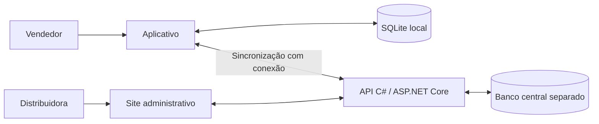

# Especificação de estrutura — distribuidora de panificação

## Objetivo e limite desta etapa

Definir a lógica e o tratamento dos dados de uma solução B2B para distribuidora de fermentos, farinhas, misturas e margarinas.

Fonte principal: texto completo da explicação do professor anexado pelo usuário em 22/10/2026. Os exemplos de cidades, quantidades e pagamentos foram mantidos como referência de negócio. Propostas adicionais são identificadas nos documentos.

Estes documentos descrevem a estrutura completa. A solução PanificaB2B implementa o fluxo acadêmico local de cadastros, roteiros, catálogo, trabalho offline, pedidos, estoque, corte, vendas simuladas e contas a receber. O README, ENTREGA.md e VALIDACAO.md da solução distinguem o que está implementado, as decisões adotadas e o que foi efetivamente verificado.

## Componentes

- Aplicativo: trabalha com carteira, roteiro, catálogo e pedidos, incluindo períodos sem conexão.
- Site: centraliza cadastros, gestão dos pedidos, estoque, faturamento e financeiro.
- API: única entrada para o banco central e suas regras.
- SQLite local: conserva dados baixados e o trabalho ainda não enviado.
- Banco central: conserva a informação oficial da distribuidora.

O SQLite do aplicativo e o banco central representam papéis diferentes, mesmo se ambos utilizarem SQLite na primeira versão acadêmica.

## Tecnologias e padrões

| Item | Situação |
|---|---|
| C# / .NET 10 | Confirmado pelo usuário |
| ASP.NET Core Web API | Direção definida para a API |
| SQLite | Solicitado pelo usuário; proposto para armazenamento local e para o banco central acadêmico separado |
| Entity Framework Core | Proposta de acesso ao banco da API |
| Tecnologia do aplicativo | .NET MAUI, confirmado pelo usuário |
| Tecnologia do site | ASP.NET Core MVC, definido para esta solução |
| Visual Studio e SDK | Projeto .NET 10; sem alterar configurações da máquina |
| IA utilizada nesta análise | Codex, da OpenAI |
| Configurações e padrões do professor | A fala exige documentá-los, mas não informa seus detalhes |

As escolhas técnicas foram confirmadas com o usuário. Nota fiscal é simulada. Nesta implementação, os encargos usam dias corridos, juros simples, multa única, desconto antecipado limitado a 10% da parcela e recebimento integral por título; essas decisões acadêmicas estão explicitadas no README.

## Cobertura do enunciado

| Requisito do professor | Onde foi tratado |
|---|---|
| Aplicativo, site e API | Lógica §1; componentes deste documento |
| Carteira, regiões e ausência de conflito comercial | Lógica §2; modelo §2 |
| Roteiro por dia, várias cidades e partes da mesma cidade | Lógica §2; Roteiro e ItemRoteiro |
| Ordem 10, 20, 30 com inserção intermediária | Lógica §2; sequência por item do roteiro |
| Cadastro de cliente pelo vendedor e pela empresa | Lógica §§3–6; Cliente |
| Download de carteira, clientes e preços | Lógica §3; modelo §§1 e 7 |
| Consulta sem conexão e envio posterior | Lógica §§4–6 |
| Envio ao meio-dia e às 19h; botão e nova tentativa | Lógica §6 |
| Última compra efetiva, quantidade e preço | Lógica §§4 e 7 |
| Dívida e situação de pagamento do cliente | Lógica §11 |
| Novidades e promoções destacadas por cor | Lógica §7; Produto e Promocao |
| Saldo exato de estoque fora do aplicativo do vendedor | Lógica §§3 e 8 |
| Cadastros com status ativo/inativo | Lógica §12; modelo de cadastros |
| Cidades, estados e grupos de produtos | Modelo §§2 e 3 |
| Pedidos de todos os vendedores e seus itens | Lógica §§6 e 8; modelo §5 |
| Quantidade pedida e quantidade atendida | Lógica §8; ItemPedido |
| Corte decidido pela distribuidora | Lógica §8 |
| Venda sem estoque negativo | Lógica §§8 e 9 |
| Cobrança somente do efetivamente atendido | Lógica §§8–11 |
| Faturamento, entrega e nota fiscal | Lógica §9; nota fiscal simulada, conforme o usuário |
| Condições e formas de pagamento distintas | Lógica §10; modelo §4 |
| Parcelas em 7/14 ou 7/14/21 dias | Lógica §10 |
| Forma diferente por parcela | Lógica §10; ParcelaCondicao |
| Multa, juros e desconto por antecipação | Lógica §11; regras acadêmicas e limites documentados no README da solução |
| Geração automática do contas a receber | Lógica §§9–11 |
| Pagamento à vista e pagamento na entrega | Lógica §§10–11 |
| Ausência inicial de limite de crédito | Lógica §11 |
| Pontualidade como apoio à decisão de corte | Lógica §8 |
| Especificação com tecnologias, IA e padrões da disciplina | Este documento |

## Cenários para validar a lógica

Estes são critérios do projeto. O registro de testes executados e os limites da verificação estão no arquivo VALIDACAO.md da solução; não se presume validação em aparelho somente pela compilação.

1. **Offline:** criar um cliente e seu pedido sem conexão; ambos continuam disponíveis após reabrir o aplicativo.
2. **Dependência:** enviar primeiro o cliente; aceitar o pedido somente depois de reconhecer seu cadastro.
3. **Resposta perdida:** a API grava o pedido, a conexão cai e o reenvio confirma o mesmo pedido sem duplicá-lo.
4. **Envio parcial:** três pedidos aceitos e dois não confirmados; apenas dois permanecem pendentes.
5. **Atualização:** baixar o catálogo sem apagar pedidos locais ainda não enviados.
6. **Roteiro:** a mesma cidade tem áreas em dias diferentes; a ordem de cada roteiro é independente.
7. **Histórico:** uma semana sem venda não muda a última compra efetivamente realizada.
8. **Corte:** pedidos de 5, 8 e 9, estoque de 15; atendimento de 2, 6 e 7; corte total de 7.
9. **Concorrência:** dois operadores confirmam sobre o mesmo estoque; nenhum saldo pode ficar negativo.
10. **Financeiro:** R$ 235,00 em duas parcelas gera R$ 117,50 + R$ 117,50.
11. **Arredondamento:** R$ 235,00 em 33,33%, 33,33% e 33,34% gera R$ 78,33 + R$ 78,33 + R$ 78,34.
12. **Prazo:** venda em 19/10, vencimentos em 7 e 14 dias: 26/10 e 02/11.
13. **Histórico financeiro:** alterar a condição cadastrada não modifica títulos existentes.
14. **Segurança:** vendedor não acessa carteira de outro nem consulta saldo exato de estoque.
15. **Inativação:** produto inativo some da nova oferta após atualização, mas permanece no histórico.
16. **Atomicidade:** falha durante o faturamento não deixa venda, estoque ou títulos parcialmente gravados.

## Documentos detalhados

- [Lógica e tratamento dos dados](LOGICA-DO-SISTEMA.md).
- [Modelo de dados e relacionamentos](MODELO-DE-DADOS.md).

Implementação e roteiro de demonstração: consulte ../README.md e ../GUIA-DE-TESTE.md.

