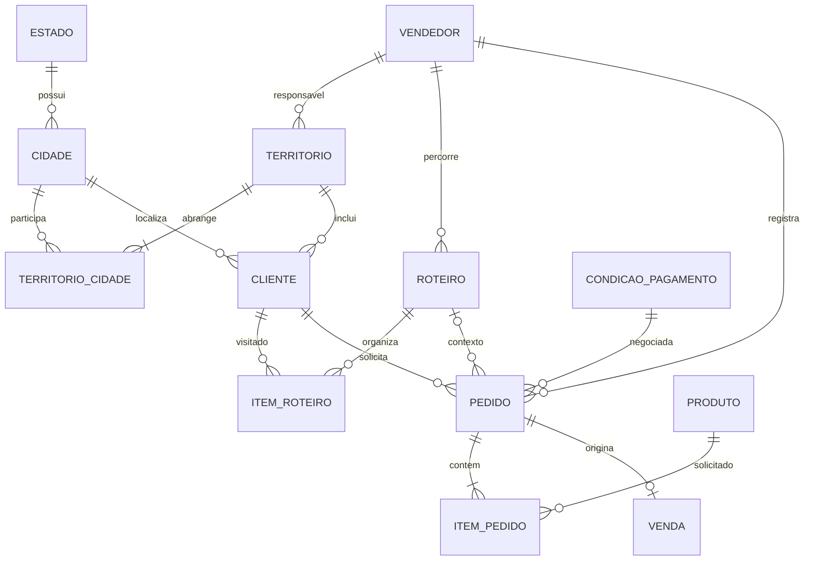
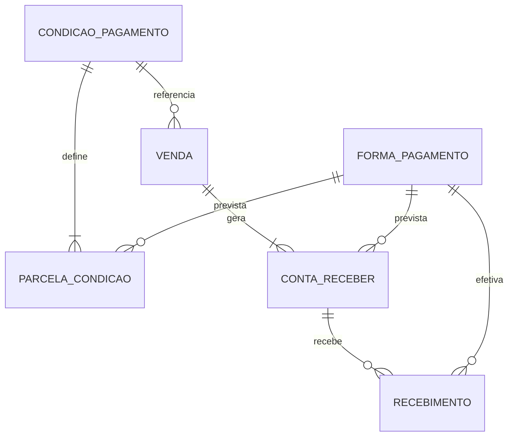
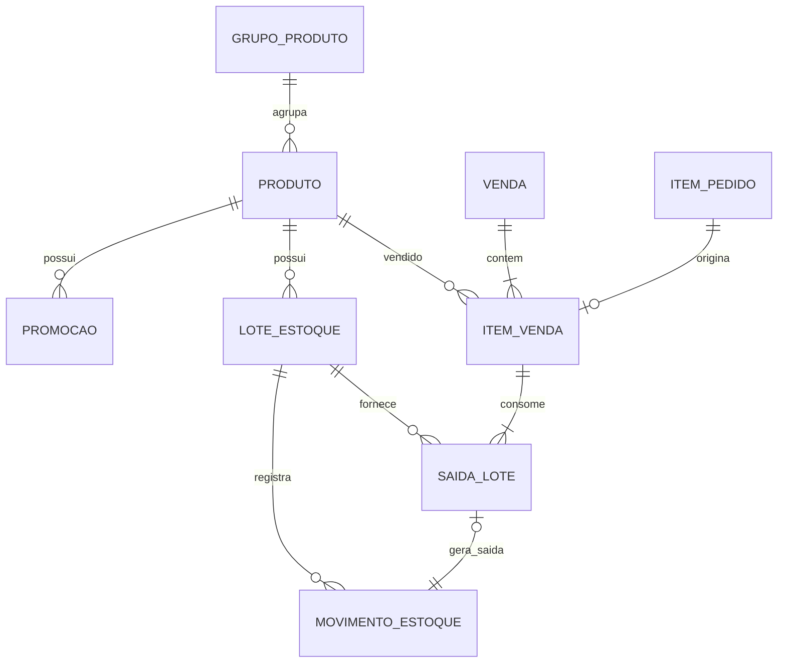

# Modelo conceitual de dados — escopo completo

Base: fala integral do professor e regras de [LOGICA-DO-SISTEMA.md](LOGICA-DO-SISTEMA.md). As seções conceituais explicam o domínio; a seção 14 identifica o esquema físico implementado e seus limites.

## 1. Distribuição dos dados

| Dados | Banco central, acessado pela API | SQLite do aplicativo |
|---|---|---|
| Cadastros comerciais | Fonte oficial | Cópia autorizada para consulta |
| Territórios e roteiros | Organizados pela distribuidora | Somente os do vendedor |
| Cliente cadastrado em visita | Recebe e valida | Cadastro provisório até confirmação |
| Pedido | Recebe a versão confirmada pelo vendedor | Rascunho e fila de envio |
| Estoque e movimentos | Controle oficial | Não baixar saldo exato |
| Vendas e histórico | Registro oficial | Histórico e resultado necessários ao vendedor |
| Financeiro | Títulos, encargos e recebimentos | Resumo autorizado, com data de atualização |
| Controle de sincronização | Identificadores aceitos, versões e respostas | Pendências, tentativas e confirmações |

O modelo de transporte da API não precisa copiar todas as colunas das tabelas. Por exemplo, a resposta de produto para o vendedor omite o saldo de estoque.

## 2. Localização, território e roteiro

| Entidade | Campos ou dados principais |
|---|---|
| Estado | Id, nome, sigla, ativo |
| Cidade | Id, EstadoId, nome, ativo |
| Vendedor | Id, nome, contato, ativo |
| Territorio | Id, nome, delimitação da área, VendedorResponsavelId, ativo |
| TerritorioCidade | TerritorioId, CidadeId |
| Cliente | Id estável, nome/razão social, documento normalizado, e-mail, telefone, endereço, CidadeId, TerritorioId, ativo, versão |
| Roteiro | Id, VendedorId, nome, dia da semana, ativo, versão |
| ItemRoteiro | Id, RoteiroId, ClienteId, sequência de visita, ativo |

Propostas:

- TerritorioCidade permite várias cidades no território e diferentes áreas da mesma cidade.
- O cliente tem um território atual. O vendedor atual é derivado dele, evitando dois campos de responsabilidade que possam discordar.
- Pedido e venda guardam o vendedor da operação para preservar o histórico.
- O cliente pode participar de roteiros em dias diferentes; não pode se repetir dentro do mesmo roteiro.
- A sequência é única por roteiro, e não globalmente nem apenas por cliente.
- Roteiro e cliente devem pertencer à mesma carteira autorizada.
- A cidade do cliente deve ser compatível com as cidades de seu território.

A delimitação territorial deve ser validada administrativamente. Uma tabela de cidades não descreve sozinha limites entre bairros.

## 3. Produtos e estoque

| Entidade | Campos ou dados principais |
|---|---|
| GrupoProduto | Id, descrição, ativo |
| Produto | Id, GrupoProdutoId, descrição, unidade de venda, preço atual, indicação/período de novidade, ativo, versão |
| Promocao | Id, ProdutoId, preço promocional, início, fim, ativo |
| LoteEstoque | Id, ProdutoId, código do lote, validade, situação |
| MovimentoEstoque | Id, LoteId, tipo, quantidade, instante, motivo, responsável, SaidaLoteId opcional |
| SaidaLote | Id, ItemVendaId, LoteId, quantidade |

Lotes, movimentos detalhados e SaidaLote são propostas para rastrear perecíveis. A fala exige estoque e validade, sem prescrever essas tabelas.

Um item vendido pode sair de vários lotes. Cada saída de lote gera exatamente um movimento de saída por venda. Entradas, perdas e ajustes não possuem SaidaLoteId.

O saldo vem dos movimentos. Se houver uma coluna de saldo para desempenho, ela deve ser atualizada na mesma transação, sem virar uma segunda fonte independente.

Promoção por lote é uma possível extensão; não foi exigida explicitamente.

## 4. Condições e formas de pagamento

| Entidade | Campos ou dados principais |
|---|---|
| FormaPagamento | Id, descrição, ativo |
| CondicaoPagamento | Id/código, descrição, taxa de multa, taxa e periodicidade de juros, taxa e periodicidade de desconto antecipado, política de cálculo, ativo, versão |
| ParcelaCondicao | Id, CondicaoPagamentoId, número, dias após a venda, percentual, FormaPagamentoId prevista |

Restrições:

- Número da parcela único dentro da condição.
- Prazo não negativo; prazo zero permite à vista.
- Percentuais positivos, somando 100%.
- Formas de pagamento podem variar entre as parcelas.
- Regras de juros e desconto precisam de periodicidade explícita.
- Referenciar o cadastro não basta para o histórico: a venda e os títulos guardam a cópia da configuração usada.

Emitir boleto ou integrar Pix não é o mesmo que cadastrar a forma de pagamento. Integrações bancárias não foram detalhadas na fala.

## 5. Pedidos

| Entidade | Campos ou dados principais |
|---|---|
| Pedido | Id estável gerado na origem, ClienteId, VendedorId da operação, RoteiroId opcional, CondicaoPagamentoId, estado, criação local, recebimento no servidor, versão, versão dos preços |
| ItemPedido | Id estável, PedidoId, ProdutoId, quantidade solicitada, preço coletado, quantidade atendida inicialmente nula, motivo do corte |
| RegistroConfirmacao | Id/chave da operação, PedidoId, resultado, responsável, instante |

RegistroConfirmacao representa a necessidade de reconhecer uma confirmação repetida; pode ser implementado por restrição e estado do próprio pedido em vez de uma tabela separada.

Um pedido recebido contém pelo menos um item válido. Um rascunho local pode estar incompleto. A quantidade atendida nula significa análise pendente; zero significa que o item foi totalmente cortado.

Condição e forma de pagamento podem precisar de ajuste autorizado antes do faturamento. Essa alteração não pode modificar silenciosamente o acordo registrado no pedido.

## 6. Venda e contas a receber

| Entidade | Campos ou dados principais |
|---|---|
| Venda | Id, PedidoId único, ClienteId, VendedorId, instante/data comercial, condição usada e sua versão/cópia, estado, identificação fiscal quando disponível |
| ItemVenda | Id, VendaId, ItemPedidoId único, ProdutoId, descrição/unidade aplicadas, quantidade efetivamente vendida, preço confirmado |
| ContaReceber | Id, VendaId, número da parcela, valor original, vencimento, FormaPagamentoPrevistaId, cópia das taxas e regras |
| Recebimento | Id/chave da operação, ContaReceberId, instante/data, FormaPagamentoEfetivaId, total recebido, principal amortizado, juros, multa, desconto, responsável, eventual referência de estorno |

Restrições:

- Proposta inicial: no máximo uma venda por pedido.
- Um item de venda referencia um item do mesmo pedido que originou a venda.
- A soma das saídas de lote corresponde à quantidade vendida.
- Número da parcela único por venda.
- A soma dos títulos gerados corresponde ao total faturado.
- Receber não altera o valor original da parcela.
- A forma realmente utilizada pode ser diferente da prevista, mediante regra da empresa; ambas ficam registradas.
- Não criar uma coluna editável de dívida no cliente.
- Pagamento duplicado por repetição de chamada deve ser impedido pela identificação da operação.

A existência de número de nota não substitui o Id da venda. O tratamento da nota fiscal depende do escopo fiscal a confirmar.

## 7. Entidades locais de sincronização

| Entidade/controle local | Dados principais | Finalidade |
|---|---|---|
| OperacaoPendente | Id estável, tipo, entidade de origem, dependências, versão/conteúdo de envio, estado, tentativas, último erro | Fila de clientes e pedidos ainda não confirmados |
| ControleSincronizacao | Vendedor/usuário, conjunto de dados, marcador do servidor, data de atualização | Saber o que baixar e quão atuais são os dados |
| RespostaSincronizacao | Id da operação/entidade, confirmação ou erro, instante | Reconciliar resposta perdida e mostrar pendências |

São controles técnicos propostos, não cadastros comerciais da distribuidora.

Uma operação cujo resultado é desconhecido após uma falha não deve ganhar outro identificador. Repetir a mesma chave permite descobrir se já foi gravada.

No caso de edição durante falha de comunicação, resolver primeiro o resultado desconhecido. Uma correção de conteúdo usa uma nova versão/ação conforme o estado confirmado, sem reaproveitar uma chave com conteúdo diferente.

Os identificadores de cliente e pedido são estáveis em todos os dispositivos. Proposta: GUID gerado na origem para essas entidades; demais identificadores podem ser definidos posteriormente.

## 8. Diagrama — carteira e pedidos

A cardinalidade obrigatória de itens se aplica ao pedido recebido. Rascunhos locais podem estar vazios.

## 9. Diagrama — financeiro

Os títulos preservam os prazos e regras aplicados. Mudar a condição cadastrada não recalcula vendas antigas.

## 10. Diagrama — mercadoria

## 11. Dados calculados e cópias históricas

| Informação | Origem/tratamento |
|---|---|
| Carteira atual do vendedor | Clientes dos territórios atribuídos a ele |
| Sequência de visita | ItemRoteiro |
| Última quantidade e último preço | Última venda válida do produto para aquele cliente |
| Quantidade cortada | Solicitada menos atendida, depois da análise |
| Estoque disponível | Movimentos dos lotes liberados e ainda válidos |
| Total da venda | Quantidades atendidas × preços confirmados, com descontos autorizados |
| Parcelas | Condição aplicada, com ajuste final de centavos |
| Saldo principal | Original do título menos principal amortizado |
| Valor de quitação | Saldo mais encargos devidos menos descontos aplicáveis na data |
| Situação vencida | Saldo em aberto e vencimento anterior à data de referência |
| Novidade/promoção vigente | Indicadores e períodos, avaliados na data |
| Preço e regra financeira históricos | Cópias preservadas na operação |

## 12. Consistência que atravessa as entidades

1. Autorização: usuário autenticado e território/carteira vigentes.
2. Sincronização: identificadores estáveis e confirmações sem duplicação.
3. Concorrência: versões para alterações e validação transacional do estoque.
4. Histórico: inativação de cadastros e preservação dos dados aplicados.
5. Financeiro: valores exatos em centavos e percentuais com precisão definida.
6. Atomicidade: faturamento, baixa e parcelas confirmados em conjunto.
7. Estorno: operação inversa rastreável, sem apagar os registros originais.

Vendedor é um cadastro comercial; não serve como prova de identidade apenas porque seu Id foi enviado na requisição.

## 13. Autenticação implementada

| Entidade | Dados principais |
|---|---|
| Usuario | Id, login, login normalizado único, hash da senha, perfil, VendedorId opcional, ativo |
| SessaoAcesso | Id, UsuarioId, expiração e indicador de sessão ativa |

Administrador, Gestor Comercial, Financeiro e Estoque/Expedição não possuem vínculo de vendedor. O perfil Vendedor exige vínculo comercial, único por vendedor nesta versão. A identidade validada pela API determina o alcance das consultas e alterações. Sessões podem ser revogadas individualmente ao sair.

No aplicativo, a identificação validada e o token ficam no SecureStorage. O cache SQLite é selecionado por vendedor; ele não fornece uma lista de carteiras para livre escolha. Senhas não são salvas no dispositivo.

## 14. Esquema físico implementado

| Tabelas | Responsabilidade e integridade |
|---|---|
| Estados, Cidades, Vendedores, Territorios, TerritorioCidades | Localidades e carteira; vínculos por chaves estrangeiras |
| Clientes | Território/cidade, documento normalizado único quando informado e versão de edição |
| Roteiros, ItensRoteiro | Vendedor/dia; cliente e sequência não se repetem no mesmo roteiro |
| Usuarios, SessoesAcesso | Hash, perfil, vendedor vinculado e sessão revogável |
| GruposProduto, Produtos | Código de produto único, preço em centavos, unidade, promoção, novidade e versão |
| FormasPagamento, CondicoesPagamento, ParcelasCondicao | Condição com código único, taxas em centésimos de percentual e forma por parcela |
| Lotes | Produto/código único, validade e saldo em milésimos; restrição de saldo não negativo e versão |
| Movimentos | Entrada, venda, perda e estorno, lote, quantidade com sinal, data e responsável |
| Pedidos, ItensPedido | GUID do dispositivo, hash do conteúdo aceito, vendedor histórico, versão, quantidades pedida/atendida e preço preservado |
| Vendas, ItensVenda | Uma venda por pedido; número simulado único, itens e total em centavos, entrega e cancelamento |
| Titulos | Venda/parcela única, vencimento, valor, forma prevista e cópia das taxas |
| Recebimentos | Idempotência por GUID, um recebimento integral por título, data, principal, encargos, desconto, forma real e responsável |
| CarteiraBaixada (dispositivo) | JSON da preparação oficial, selecionado pelo vendedor |
| OperacoesPendentes (dispositivo) | JSON original de cliente/pedido, identificação estável, vendedor, situação, mensagem e atualização |

O esquema conceitual de recebimentos parciais/amortização é uma evolução: fisicamente, esta versão mantém Pago/Cancelado no título e quitação integral discriminada no recebimento. Saldo e encargos são calculados para uma data, sem lançar multa novamente ao consultar.

Todas as tabelas centrais são acessadas pela API. DTOs do vendedor omitem lotes e movimentos de estoque. O banco central e o arquivo do dispositivo são independentes; sincronizar não significa copiar o arquivo SQLite.
